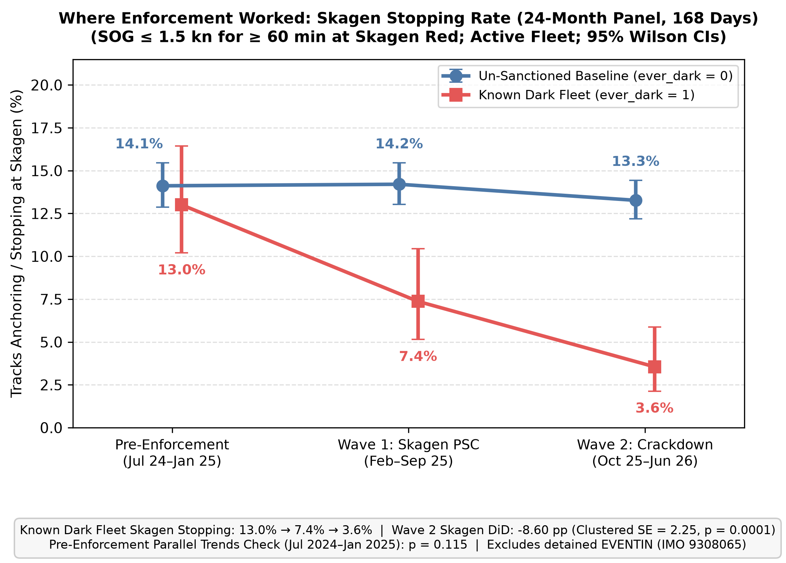
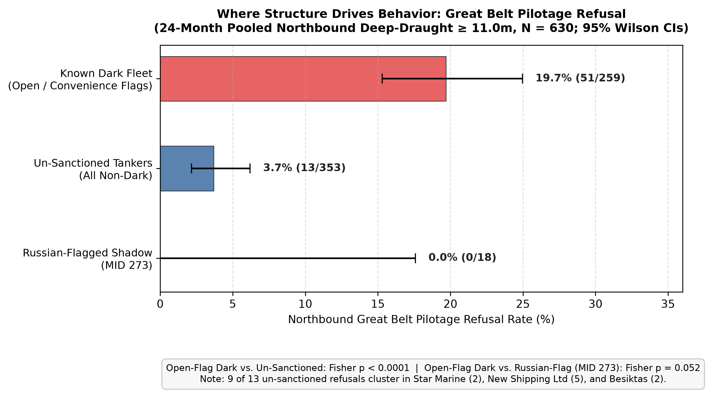

# Danish Straits Shadow-Fleet OSINT Pipeline

An end-to-end open-source maritime intelligence (OSINT) pipeline measuring Russian shadow-fleet evasion and regulatory displacement in the Danish Straits using **zero paid satellite AIS feeds, zero commercial ownership databases, and zero classified intelligence**.

By combining 24 months of public Danish Maritime Authority (DMA) AIS telemetry with OpenSanctions vessel registries, this project evaluates Denmark's 2025 anchorage enforcement crackdowns and demonstrates how "negative-signal" behavioral telemetry—specifically underway pilotage refusal in the Great Belt—surfaces unsanctioned Russian-oil carriers months before formal sanctions designations.

---

## Headline Findings

| Analytical Dimension | Key Result |
| :--- | :--- |
| **Dataset Scope** | **24 months** (Jul 2024 - Jun 2026; fixed mid-month rule, days 10-16 = **168 days**); **10,694** raw tanker tracks (**10,675** active tracks across **2,801** unique vessels after excluding 19 stationary detention rows from *EVENTIN*, IMO `9308065`); **944** clean interior deep-draught ($\ge 11.0\text{ m}$) Great Belt transits (**630** northbound, **242** southbound). |
| **Anchorage Enforcement Worked (Skagen Red)** | Known dark-fleet stopping at Skagen fell monotonically from **13.0%** (Pre) to **7.4%** (Wave 1) to **3.6%** (Wave 2), while unsanctioned commercial traffic stayed flat (14.1% to 14.2% to 13.3%). Vessel-clustered Difference-in-Differences (DiD) estimates a net drop of **-5.73 pp** ($p = 0.016$) in Wave 1 and **-8.60 pp** ($p = 0.0001$; **-8.77 pp** with size/draught controls) in Wave 2. Dark-fleet bunkering in Danish waters dropped to **0.00%** in Mar-Jun 2026 (Wave 2 DiD: **-3.77 pp**, $p = 0.0011$). |
| **Underway Enforcement Stalled (Route T Pilotage)** | Directional placebo testing validates the pilot-boat matching algorithm: **99.59%** of southbound deep-draught tankers accepted DanPilot escort (`1/242` refused) versus **10.16%** refusing northbound (`64/630`, Fisher $p < 0.0001$). Among open-registry dark-fleet tankers exiting the Baltic, refusal averaged **19.69%** (`51/259`) and persisted across both enforcement waves (16.7% to 20.0% to 23.1%). |
| **The Russian-Flag Paradox (`MID 273`)** | As Moscow reflagged hulls under its own sovereign registry, northbound Russian-flagged shadow transits surged **14-fold** (`1` to `3` to `14`), yet complied with Danish pilotage **100% of the time** (`0/18` refusals vs. `19.69%` open-flag dark, Fisher $p = 0.052$). |
| **Blind Behavioral Triage** | Filtering unsanctioned (`ever_dark = 0`) tankers strictly by northbound pilotage refusal surfaced **10 hulls** (`13` refusals)—including clustered Western-insured Greek/Turkish operators (*New Shipping Ltd*, *Besiktas*) and *Star Marine* SPVs—**100%** of which were independently verified lifting Russian Baltic crude. |

---

## Key Visuals

### 1. Where Enforcement Worked: Skagen Anchorage Collapse


### 2. Where Enforcement Stalled: Structural Pilotage Refusal & the Russian-Flag Paradox


*(Supplementary monthly bunkering and quarterly pilotage time-series charts are stored in `figures/fig3_event_study_24m.png`.)*

---

## Methodology & Architecture

1. **Watchlist Linkage (`src/01_build_watchlist.py`):** Parses public OpenSanctions bulk vessel records (`opensanctions_vessels.csv`, snapshot **2026-11-19**) into IMO-keyed (`9,492` IMOs; `2,139` sanctioned/known shadow across U.S. OFAC, EU, UK FCDO, Canada, Switzerland, and Ukraine GUR feeds) and MMSI-fallback Parquet tables. Holding watchlist membership fixed as a retrospective cohort prevents mid-study group switching from biasing DiD estimates.
2. **Streaming AIS ETL & Spatial Matching (`src/02_run_event_study_pipeline.py`):** Streams daily DMA AIS ZIP archives in 500k-row chunks, downsamples Tanker and Pilot pings to 1-minute resolution, auto-deletes raw archives to keep disk usage under ~3 GB, and computes two behavioral signals month-by-month using `SciPy` `cKDTree` spatial indexing:
   * **Skagen Stopping & Bunkering:** Tankers maintaining $\le 1.5\text{ knots}$ for $\ge 60\text{ minutes}$ inside Skagen Red ($57.55^\circ\text{N}$ to $57.95^\circ\text{N}$, $10.45^\circ\text{E}$ to $11.10^\circ\text{E}$), and all-to-all tanker pairs lingering within `250 m` for $\ge 60\text{ minutes}$.
   * **Route T Pilotage Rendezvous:** Clean interior passages (trimmed 18 hours from each 7-day boundary) by deep-draught ($\ge 11.0\text{ m}$, IMO `SN.1/Circ.263` threshold) tankers matched against Danish pilot boats (`MID 219/220` or `DANPILOT/LODS`) within `450 m` ($\ge 2\text{ minutes}$ within `600 m`).
3. **Econometric Evaluation & Three-Layer Triage (`notebooks/event_study_analysis.ipynb`):**
   * Pre-enforcement parallel-trends tests (Jul 2024 - Jan 2025: Skagen $p = 0.115$, bunkering $p = 0.590$, pilotage $p = 0.146$).
   * Vessel-clustered 3-regime DiD regressions (Wave 1: Feb 2025 Skagen PSC push; Wave 2: Oct 2025 crackdown) and within-vessel fixed effects across `100` repeat northbound hulls (`245` transits).
   * Three-layer unsanctioned anomaly screening: **Layer 1** northbound pilotage refusers (`10` IMOs, exported to `results/triage_unsanctioned_refusers.csv`), **Layer 2** deep-draught flag-hoppers (`33` IMOs across $\ge 2$ MIDs), and **Layer 3** disappearing Skagen regulars (`8` IMOs).

---

## Repository Structure

```text
danish-straits-shadow-fleet/
├── README.md
├── requirements.txt
├── .gitignore
├── src/
│   ├── 01_build_watchlist.py            # OpenSanctions IMO/MMSI Parquet builder
│   └── 02_run_event_study_pipeline.py   # Resumable 24-month DMA AIS ETL & cKDTree engine
├── notebooks/
│   └── event_study_analysis.ipynb       # DiD regressions, placebo checks, triage & figures
├── results/
│   └── triage_unsanctioned_refusers.csv # Exported Layer 1 unsanctioned pilotage refuser roster
└── figures/
    ├── fig1_skagen_enforcement.png
    ├── fig2_pilotage_architecture.png
    └── fig3_event_study_24m.png
```

---

## Reproducibility

Raw DMA daily AIS archives (~150+ GB uncompressed across 168 days) and intermediate Parquet files are excluded via `.gitignore`. To reproduce the full pipeline locally:

1. Install dependencies:
   ```bash
   pip install -r requirements.txt
   ```
2. Download the public OpenSanctions bulk vessel dataset (`opensanctions_vessels.csv`) from [OpenSanctions](https://www.opensanctions.org/datasets/default/) into the repository root and run:
   ```bash
   python src/01_build_watchlist.py
   ```
3. Run the resumable 24-month DMA AIS ingestion and spatial matching pipeline (downloads public daily archives directly from the Danish Maritime Authority):
   ```bash
   python src/02_run_event_study_pipeline.py
   ```
4. Execute `notebooks/event_study_analysis.ipynb` to regenerate all statistical tables, triage outputs, and figures.

---

## Data Sources
* **AIS Telemetry:** [Danish Maritime Authority (DMA) Historical AIS Data](https://web.ais.dk/aisdata/) (Public Domain)
* **Sanctions & Shadow-Fleet Watchlists:** [OpenSanctions](https://www.opensanctions.org/) consolidated maritime dataset (U.S. OFAC SDN/CSL, EU, UK FCDO, Canada SEMA, Switzerland SECO, Ukraine GUR *War & Sanctions*)